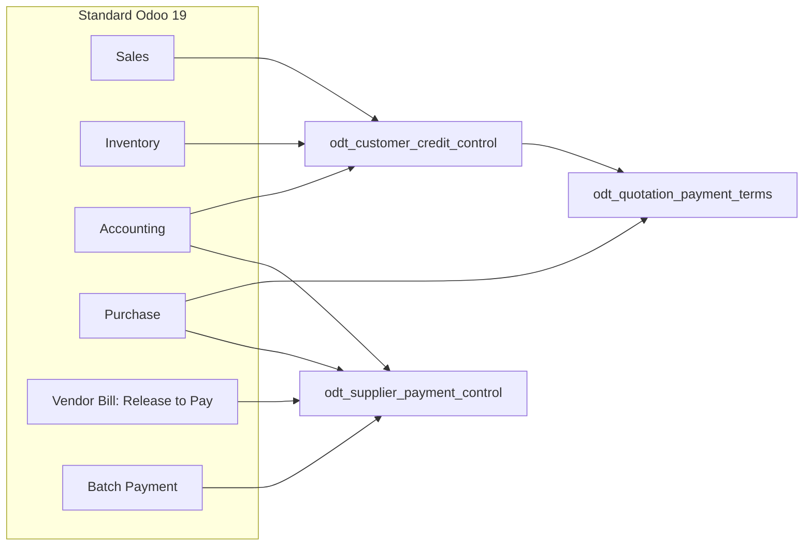
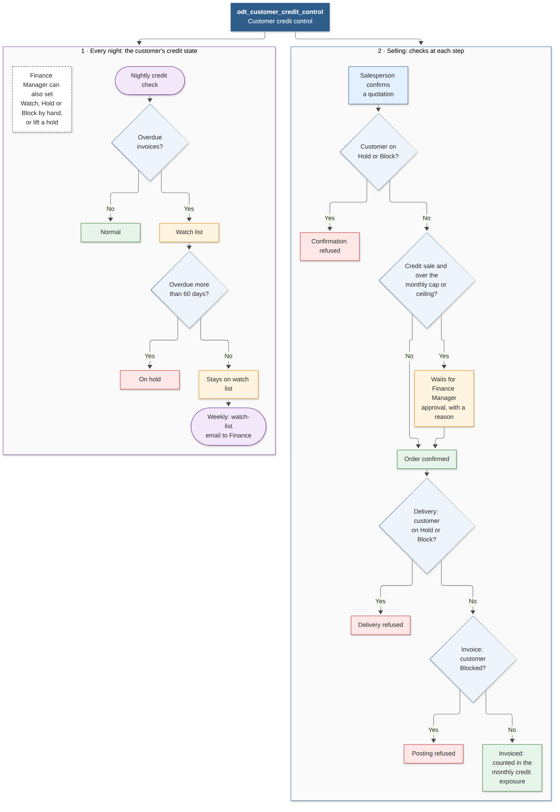
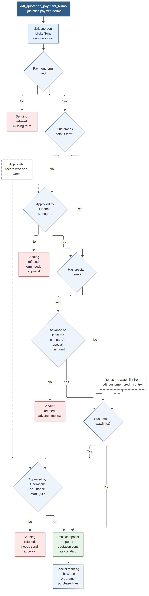
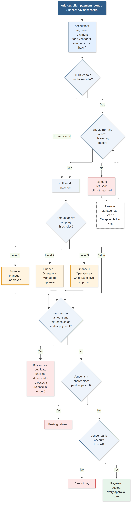

# RVK Credit & Payment Controls

<p align="center">
  
</p>

<p align="center">
  <strong>Odoo 19 Enterprise modules for RVK: credit control on sales, payment terms on quotations, and controlled supplier payments</strong><br/>
  Monthly credit caps • Customer holds and blocks • Approved payment terms • Matched bills only • Approval levels by amount
</p>

<p align="center">
  <strong>Author:</strong> OdooTec <br/>
  <strong>Official Website:</strong> <a href="https://www.odootec.com">www.odootec.com</a> • <strong>Inquiries:</strong> <a href="mailto:info@odootec.com">info@odootec.com</a>
</p>

<p align="center">
  <a href="#modules">Modules</a> •
  <a href="#how-the-modules-fit-together">Architecture</a> •
  <a href="#workflows">Workflows</a> •
  <a href="#installation--configuration">Installation</a> •
  <a href="#tests-and-quality">Quality</a> •
  <a href="#documentation">Documentation</a> •
  <a href="#support">Support</a>
</p>

---

## Modules

| Module | What it does | Requirements |
|---|---|---|
| [`odt_customer_credit_control`](odt_customer_credit_control/) | Caps monthly credit sales per customer and per company. A nightly check puts customers with overdue invoices on the watch list or on hold, and Finance can block a customer. Held or blocked customers cannot have orders confirmed, deliveries validated or invoices posted. | REQ-022, REQ-023 |
| [`odt_quotation_payment_terms`](odt_quotation_payment_terms/) | A quotation is sent only on an approved payment term, with the minimum advance for special items, and with a manager's approval for watch-listed customers. | REQ-024 (and REQ-023 for sending) |
| [`odt_supplier_payment_control`](odt_supplier_payment_control/) | Vendors are paid only for bills matched to their purchase order and receipt, once, after the approvals each amount requires (Finance Manager, Operations Manager, Chief Executive). Duplicates are blocked and shareholders are kept off payroll accounts. | REQ-104, REQ-105 |

All three are **Odoo 19.0 Enterprise**, version `19.0.1.0.0`, licensed under ODTL-1.

---

## How the modules fit together



- **Install order:** `odt_customer_credit_control` comes first, because `odt_quotation_payment_terms` reads its watch list and its special-item marking. `odt_supplier_payment_control` is independent and can be installed at any time.
- **Multi-company:** every threshold, ceiling and hold rule is set per company. Record rules keep each company's approvals and exposure lines separate.

---

## Workflows

### Customer credit control


### Quotation payment terms


### Supplier payment control


---

## Installation & Configuration

1. Clone this repository and add its folder to the Odoo `addons_path`:
   ```
   addons_path = <odoo>/addons,<odoo>/odoo/addons,<enterprise>,<path to this repository>
   ```
2. Restart Odoo, update the Apps list, then install the modules (credit control before quotation terms). From the command line:
   ```bash
   odoo-bin -c odoo.conf -d <database> -i odt_customer_credit_control,odt_quotation_payment_terms,odt_supplier_payment_control
   ```
3. Configure each company:
   - **Credit control:** the monthly credit ceiling, the hold threshold in overdue days, each customer's monthly cap, and which payment terms count as full advance.
   - **Quotation terms:** the minimum advance for special items. Mark special products on the product form.
   - **Supplier payments:** the three approval thresholds. Give the Operations Manager and the Chief Executive their approver groups, mark shareholders and payroll expense accounts, and mark verified vendor bank accounts as trusted.

Each module's README lists its settings, groups and known limitations.

---

## Tests and quality

| Module | Tests | OdooTec standard check |
|---|---|---|
| `odt_customer_credit_control` | 32 | 87/100: 0 errors, 3 warnings (see below) |
| `odt_quotation_payment_terms` | 14 | 100/100 |
| `odt_supplier_payment_control` | 28 | 100/100 |

On 2026-10-15, all **74 tests passed** (0 failed, 0 errors) on a freshly created database and on the configured RVK database. To run them:

```bash
odoo-bin -c odoo.conf -d <test database> -i odt_customer_credit_control,odt_quotation_payment_terms,odt_supplier_payment_control \
  --test-enable --test-tags /odt_customer_credit_control,/odt_quotation_payment_terms,/odt_supplier_payment_control --stop-after-init
```

The remaining warnings on credit control:
- **SCO004:** the module extends Sales, Inventory and Accounting. Splitting it into bridge modules is a possible later refactor and changes no behaviour today.
- **UX001:** it flags the `credit.decision` dialog for having no list view. That's a false positive, because it is a popup dialog.
- **STR004:** it wanted a repository `.gitignore`. Now added.

Every module ships its Arabic translation (`i18n/ar.po`), its LICENSE and a README in the OdooTec house structure.

---

## Documentation

| Document | Where |
|---|---|
| Suite technical overview (2 pages) | [`RVK_Technical_Overview.pdf`](RVK_Technical_Overview.pdf) |
| Suite user manual, with screenshots | [`RVK_User_Manual.pdf`](RVK_User_Manual.pdf) |
| Module completeness checklist | [`COMPLETENESS.md`](COMPLETENESS.md) and [`RVK_Completeness_Checklist.pdf`](RVK_Completeness_Checklist.pdf) |
| Functional and technical guide per module | `doc/` inside each module: [credit control](odt_customer_credit_control/doc/), [quotation terms](odt_quotation_payment_terms/doc/), [supplier payments](odt_supplier_payment_control/doc/) |
| Module reference (models, rules, settings, limitations) | each module's `README.md` |

The screenshots come from a demo database with neutral sample data.

---

## How these modules were produced

The modules come from OdooTec's Datum pipeline. Every feature traces back to a numbered requirement:

1. **gen-dftr**: Delivery Requirements, Functional Requirements and the SRS, with every open question answered and sealed.
2. **gen-sdd**: the Software Design Description, which splits the requirements into these three modules and is cleared by a reviewer.
3. **gen-module**: builds each module from the SDD with spec-driven development, one agent per module, and tests them together.
4. **odootec-module-standardization**, **odoo-module-docs** and **odootec-suite-docs**: apply the OdooTec code standard and write the documentation.

---

## Licensing & Terms

Every module is licensed under the **OdooTec Development Licence (ODTL-1), version 1.4**. See the `LICENSE` file in each module.

* Ownership, commercial and distribution rights are held exclusively by **OdooTec**.
* Deployment, modification and use are governed by the signed agreement between OdooTec and the licensed client.
* Redistribution, sublicensing or publication of this source code without OdooTec's written permission is prohibited.

---

## Support

For technical assistance or inquiries:
* **Vendor**: OdooTec
* **Website**: [https://www.odootec.com](https://www.odootec.com)
* **Email**: [info@odootec.com](mailto:info@odootec.com)
